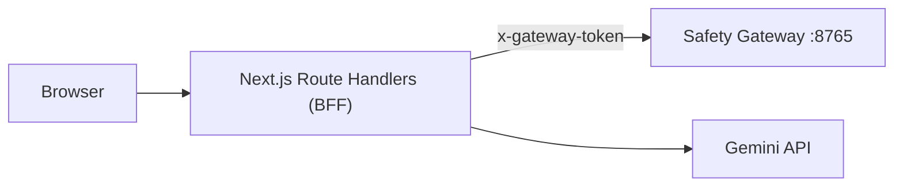

# ai-guard

兒童 AI 學習夥伴（Next.js）＋ Python Safety Gateway（個資／內容／圖片安全）。

## Tech Stack

* 套件管理: `pnpm`（Node 22+）
* 前端／BFF: `Next.js 16`（App Router、Route Handlers）、`Tailwind CSS`、`Shadcn UI`、`TypeScript`
* Safety Gateway: Python 3.11、FastAPI、Presidio、spaCy `zh-core-web-md`、RapidOCR、OpenCV
* 外部服務: Google Gemini API
* 部署: 暫定本機執行，透過 Cloudflare Tunnel 對外

## 架構



原則：**安全檢查一律在伺服器端強制**，瀏覽器不被信任。

* 每則使用者訊息（含歷史）在送模型前都會經 Gateway 檢查／代號化。
* 圖片只接受經 Gateway 遮罩產生的版本。
* 模型回覆回到孩子前會再過一次出站柵欄。
* Gateway 失聯時拒絕服務（fail-closed），不會把未檢查內容送給模型。
* 所有外部呼叫都有 timeout；Gemini 有 retry + backoff + 模型備援。

| 路由 | 類型 | 用途 |
|------|------|------|
| `/` | 靜態 | 探索首頁 |
| `/theme` | 靜態 | 探索主題 |
| `/theme/[slug]` | 動態 | 個別探索主題頁面 |
| `/history` | 靜態 | 對話紀錄 |
| `/chat` | 靜態 | 建立新對話 |
| `/chat/[slug]` | 動態 | 指定對話頁面 |
| `/safety` | 靜態 | AI 安全小幫手 |
| `/safety/[slug]` | 動態 | 個別 AI 安全主題頁面 |
| `/parent` | 靜態 | 家長頁面（尚待實作） |
| `/mobile/notify` | 靜態 | 家長通知與安全事件詳情（本機示範） |
| `/mobile/confirm` | 靜態 | 家長待確認事項及審核詳情（本機示範） |

家長待確認清單與通知共用同瀏覽器的安全事件，只列出尚待確認的項目。從通知或清單開啟待確認事項時，皆進入 `/mobile/confirm`；高風險及已保護詳情仍在通知頁。

### 主要 API（Next）

| 端點 | 用途 |
|------|------|
| `POST /api/chat/completions` | 對話（`profile: chat \| writing`，伺服器端組 system prompt） |
| `POST /api/safety/inspect` | 文字個資／內容檢查 |
| `POST /api/safety/redact-image` | 圖片遮罩 |
| `POST /api/voice/transcribe` | 語音轉文字 |
| `POST /api/theme/writing/*` | 寫作主題 classify / generate / summarize |
| `POST /api/watch/turn` | 手錶語音流程 |
| `GET /api/health`、`GET /api/ready` | 存活／就緒探針 |

### Gateway API（`python -m safety_gateway.server`）

`/healthz`、`/readyz`、`/api/inspect`、`/api/sanitize`、`/api/moderate-output`、
`/api/redact-image`、`/api/session/reset`。除探針外都需要 `x-gateway-token`（若有設定）。

## 開始

```bash
cp .env.example .env.local      # 填入 GEMINI_API_KEY、GEMINI_MODEL
pnpm install
pnpm dev                        # http://localhost:3000
```

另開終端機啟動 Gateway：

```bash
python3 -m venv .venv
.venv/bin/pip install -e ".[server]"
.venv/bin/python -m safety_gateway.server      # 預設 127.0.0.1:8765
```

`/readyz` 回 200 代表模型已暖機完成。環境變數見 `.env.example`。

* 對外部署：`GATEWAY_ENV=production` 並在 Next 與 Gateway 設同一把 `SAFETY_GATEWAY_TOKEN`（≥16 字元）。
* 除錯用 playground（含證據檢視）：`.venv/bin/pip install -e ".[playground]"`，
  `.venv/bin/python -m safety_gateway.playground --port 8766`，**不要對外**。

## 驗證

```bash
pnpm exec tsc --noEmit && pnpm lint
.venv/bin/python -m pytest
.venv/bin/python scripts/smoke_e2e.py     # 端對端：Gateway + 真實 route handlers
.venv/bin/python scripts/load_check.py      # 併發壓測：token 穩定、session 隔離、延遲
```

### 大規模評測與本機訓練的語意分類器

不爬取有害網站（法律與倫理風險、標註品質差）；改用公開授權資料集，並用合成資料補 PII 與「孩子口吻」。
**所有原始資料、建好的語料、嵌入模型與訓練產物都在 `.cache/`（已 git-ignore），不會被提交。**

```bash
pip install -e ".[train]"                                  # scikit-learn、tokenizers、opencc（僅訓練/評測用）
.venv/bin/python scripts/eval_corpus.py fetch              # 公開資料集 → .cache/eval-corpus（HF 部分需對外網路）
.venv/bin/python scripts/eval_corpus.py build              # 簡轉繁、去重、train/val/test 三分、評測用有上限的子集
# 句向量模型（ONNX，放 .cache/models/embedders/<名稱>/{model_quantized.onnx,tokenizer.json}），例如：
#   https://huggingface.co/Xenova/multilingual-e5-base  （mean pooling，前綴 "query: "）
.venv/bin/python scripts/train_content_model.py \
    --embedder .cache/models/embedders/multilingual-e5-base --pooling mean --prefix "query: " --synth-weight 6
.venv/bin/python scripts/eval_corpus.py run --split test --engine combined   # 公開資料 test 切分
.venv/bin/python scripts/eval_corpus.py run --challenge --engine combined    # 手寫挑戰集（開發用）
.venv/bin/python scripts/eval_corpus.py run --synth --engine combined        # 沒見過的模板家族
.venv/bin/python scripts/eval_corpus.py run --holdout --engine combined      # 最終保留集（不可拿來調參）
.venv/bin/python scripts/eval_pii_synth.py --n 150                           # PII：合成資料 × 雜訊
```

`--engine rules|model|combined`：只用規則 / 只用模型 / 兩者並用（Gateway 實際行為）。

**架構**：`ContentSafetyStep` 先跑片語規則（高精度），沒命中才問 `ContentModel`。`ContentModel` 把三個訊號混成一個分數：
字元 n-gram 線性模型、句向量線性頭（`multilingual-e5-base`），以及**微調過的小型編碼器**（`FinetunedClassifier`，
`multilingual-e5-small/base` 端到端微調後匯出 int8 ONNX，約 5~12 ms/句，4 類：allow / toxic / unsafe / injection）。
混合權重與毒性／不安全／注入三類各自的門檻，都在驗證集上擬合。模型只看入站的孩子短訊息，出站（模型回覆）仍只用規則。
執行端只需要 numpy、onnxruntime、tokenizers；torch 只在訓練時用，且安裝在 git-ignore 的 `.cache/pylib-ft`，不會進 `.venv`。
產物是 `weights.npz`（`allow_pickle=False`）、`meta.json`、`embedder/`、`finetuned/`，沒有 pickle。
沒有產物時 Gateway 自動退回純規則；用 `GATEWAY_CONTENT_MODEL_DIR` 指定目錄（指定了就必須存在，否則啟動失敗），
`GATEWAY_CONTENT_MODEL_DIR=off` 關閉；開發環境預設使用 `.cache/models/content_safety`；`/readyz` 會回報 `content_model`。

```bash
# 微調（需要 torch；Apple Silicon 會自動用 MPS，e5-small 約 15 分鐘、e5-base 約 45 分鐘）
pip install --target .cache/pylib-ft torch transformers onnx
.venv/bin/python scripts/finetune_content_model.py --model intfloat/multilingual-e5-small --out .cache/models/ft/e5-small
# 把微調結果與字元頭、嵌入頭混合，並在驗證集上擬合混合權重與門檻
.venv/bin/python scripts/train_content_model.py --embedder .cache/models/embedders/multilingual-e5-base \
    --pooling mean --prefix "query: " --synth-weight 6 --finetuned .cache/models/ft/e5-small --out .cache/models/content_safety
EVAL_MODEL_DIR=.cache/models/<候選> .venv/bin/python scripts/eval_corpus.py run --challenge --engine combined   # 比較候選模型
```

**姓名（PII）精準度**：`scripts/eval_pii_names.py` 在良性語料上量 PERSON 誤判率，並用 1000 個內政部常見姓名量召回；
`scripts/derive_name_stoplist.py` 從公開良性文字統計「其實是一般詞」的片段（黃瓜、史詩、「生成」裡的「成」），
產出只含詞語的 `safety_gateway/pii/name_stoplist.py`。統計只用 dev 切分，驗證只看 test 切分。

**怎麼看數字（避免自欺）**
- 只有「來源自帶標籤」的集合算指標；Safety-Prompts 的 `Reverse_Exposure` 是**混合集**（含真攻擊），不當負例也不訓練。
- 資料依雜湊切 train / val / test；規則與門檻只能看 train/val，**test 與 holdout 只引用不調參**。
- 長度分桶加權，避免模型只學「文體／長度」；並加入大量「同句型、良性」的負例（alpaca-zh、TaiwanChat、
  `reverse_protective`、`tests/synth_content.py` 的反事實模板）。
- 公開資料的 test 切分會**高估**（Safety-Prompts 是模板化資料，近似句會落在兩邊）；真正的量尺是
  `tests/fixtures/content_safety_challenge.jsonl`、`content_safety_holdout.jsonl`（兩份都已被看過漏判清單，視為開發集）與
  `content_safety_holdout2.jsonl`（全新、訓練前寫好，只在選定最終模型後讀取）。
  這兩份由同一人手寫，樣本小（約 110 句），信賴區間寬，請當作方向而非保證。
- 每個比例都附 Wilson 95% 信賴區間；`macro` = 各集合等權平均的「判斷正確率」。

更完整的功能與流程見 `專案功能與流程.md`。
