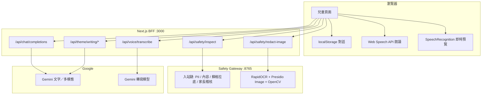
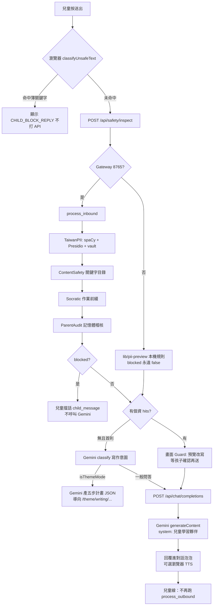
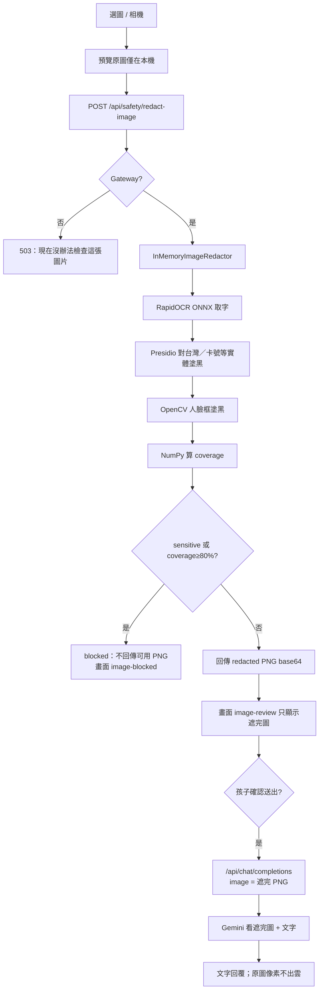
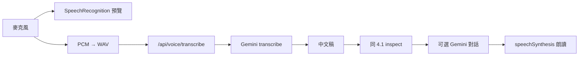
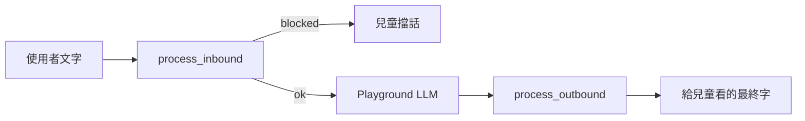

# 遠傳智靈 AI 心守護：功能、能力邊界與啟動流程

本文以目前程式為準，整理**兒童 Next 產品**與本機 **Python Safety Gateway**。對象是工程與產品對齊：每個功能做到哪、經過哪些套件、何時打 LLM、畫面會看到什麼。

---

## 1. 系統怎麼切

瀏覽器只打 Next（BFF）。個資、內容擋、圖檔遮罩在 Gateway。要產生自然語言回覆、寫作計畫、語音轉文字時，才由 Next 伺服器呼叫 **Google Gemini**（`@google/genai`）。金鑰只在伺服器端（`.env.local`）。

| 層 | 技術 | 職責 |
| --- | --- | --- |
| 兒童 UI | Next.js 16、React 19、Tailwind、Shadcn | 畫面、對話存在 `localStorage`、注音、瀏覽器 TTS |
| Next Route Handlers | TypeScript | 轉發 Gateway、組兒童 system prompt、呼叫 Gemini |
| Safety Gateway | Python 3.11、FastAPI playground、Presidio、spaCy `zh-core-web-md`、RapidOCR、OpenCV 人臉 | 入站／出站柵欄、OCR 遮圖、session vault |
| 雲端 LLM | Gemini（`GEMINI_MODEL`）+ 轉寫（`GEMINI_TRANSCRIBE_MODEL`，預設 `gemini-3.5-transcribe`） | 對話、寫作 JSON、STT |



Gateway **沒開**時：文字 inspect 會退回 Next 本機 regex（`lib/pii-preview.ts`），**不擋內容、也不做 spaCy**；圖片 redact 直接 503，無法測 OCR／證件攔截。

---

## 2. 本機啟動（測完整安全路徑）

兩個行程都要開。兒童產品測圖／個資請以 **Next :3000 + Gateway :8765** 為準。

```bash
# 終端 1：網站
pnpm install
pnpm dev
# http://localhost:3000

# 終端 2：Gateway（含 OCR）
.venv/bin/python -m safety_gateway.playground --host 127.0.0.1 --port 8765
# http://127.0.0.1:8765
```

`.env.local` 至少：`GEMINI_API_KEY`、`GEMINI_MODEL`、`SAFETY_GATEWAY_URL=http://127.0.0.1:8765`。

Python playground 自己也能聊天並跑 **outbound** 柵欄；兒童 UI **目前沒有**把 Gemini 回覆再送進 `process_outbound`。

---

## 3. 功能總表

| 功能 | 做到什麼程度 | LLM？ | 主要套件／模組 |
| --- | --- | --- | --- |
| 文字個資檢查與改寫 | 台灣姓名／電話／證號／學校等；Gateway 用 Presidio + 自訂 recognizer；失敗則本機規則 | 檢查階段無 | spaCy md、Presidio、session vault |
| 入站內容擋 | 關鍵字／短語目錄，非語意模型 | 無 | Gateway `ContentSafetyStep`；兒童頁另有較薄的 `classifyUnsafeText` |
| 蘇格拉底作業引導 | 入站可加教學前綴；playground 出站會擋「直接給完整答案」 | 兒童線主要靠 prompt | `SocraticPedagogyStep`、`CHILD_LEARNING_PARTNER_PROMPT` |
| 圖片 OCR 與防洩漏 | RapidOCR 讀字 + 人臉塗黑；信用卡／證件等敏感類 **全擋**；塗黑面積 ≥80% 全擋；**不分類血腥／裸露** | 遮罩階段無；通過後才可能把遮完 PNG 給 Gemini | RapidOCR ONNX、Presidio image redactor、OpenCV、Pillow、NumPy |
| 兒童對話 | 只送已處理文字 + 可選遮完圖；system prompt 當軟角色 | **有** Gemini | `@google/genai` |
| 輸出端柵欄 | playground 有；兒童 Next **尚未接** | 兒童線僅 prompt | Gateway `process_outbound` |
| 語音提問 | 瀏覽器即時預覽 + PCM WAV 送 Gemini STT，再走文字安全 | **有** 轉寫模型 | Web Speech API、`/api/voice/transcribe` |
| 回覆朗讀 | 本機 TTS，不耗 Gemini | 無 | `speechSynthesis`、`lib/speak-text.ts` |
| 注音 | `pinyin-pro` + 少數台灣覆寫表 | 無 | `lib/zhuyin.ts` `TAIWAN_READINGS` |
| 寫作主題 | 首則無個資時用 Gemini JSON 判斷是否進五步寫作 | **有**（classify / generate / summarize） | `lib/writing.ts` |
| 安全課程頁 | 靜態教案＋互動卡 | 課程本身無 | `/safety/*` |
| 家長頁 | 路由存在，產品尚未實作 | — | `/parent` |
| 暴力／NSFW 圖 | **未做視覺分類** | 未接 | 見第 3.4 節 |

---

## 4. 各功能流程

### 4.1 文字送出：個資 + 內容安全 +（可選）寫作分流 + 對話

**能力：** 真名、電話、身分證、學校等可被標成 `<PERSON_1>` 這類 token，畫面給兒童看「改寫後」句子；Gateway 若判定不當內容會 `blocked`，用兒童擋話，**不打 Gemini**。第一則無個資時，可能被分流成寫作工作室。

**做不到：** 100% 抓暱稱、錯字證號、語意繞過關鍵字（「怎麼讓自己消失」未必命中「自殺」）。Gateway 掛掉時本機 fallback **不擋**內容。



**LLM 參與：** inspect／擋話 **沒有**。寫作分類與計畫、以及通過後的對話 **有**。兒童回覆是模型自由生成；沒有第二道本機掃描。

**兒童會看到：** 正常助教回答；或擋話；或個資預覽卡；或跳寫作頁。

---

### 4.2 圖片：OCR、證件／信用卡、人臉（第 4 點測這條）

**能力：** 上傳 ≤4MB。Gateway 在記憶體遮罩：RapidOCR 認圖上的字 → Presidio 對實體塗黑 → OpenCV 塗臉。政策：

- 實體含 `CREDIT_CARD`、`TW_ID`、護照、駕照、銀行帳號、IBAN 等 → **擋**（`sensitive`）
- 像素變更比例 ≥ **0.80** → **擋**（`coverage`）
- 否則回傳遮完 PNG；兒童確認後，**只有這張**可進 Gemini（多模態）

**做不到：** 保證 OCR 不漏模糊／斜拍卡號；**不判斷**血腥、裸露、偷拍（`image_policy.py` 註解寫明）。Gateway 沒開則無法檢查圖片。



**LLM 參與：** 遮罩與攔截 **沒有**。通過並送出後，Gemini 可能描述「遮完的」畫面，仍可能從殘留版面推測證件類型，但應看不到完整證號／臉。

**測法：** 對話頁上傳信用卡或身分證件照。預期敏感類直接擋，或大面積塗黑擋。通過時預覽應是黑塊圖，不是原圖。

---

### 4.3 語音提問與朗讀

**能力：** 首頁／對話麥克風進聽寫 UI。`SpeechRecognition` 做即時字幕（不穩、依賴瀏覽器）。真正送出前把錄音轉 PCM WAV，打 Gemini 轉寫（`zh-TW`）。轉寫結果再走 **4.1 文字安全**。回覆用瀏覽器 TTS，不呼叫 Gemini TTS。

**做不到：** 離線穩定 STT；Live API 雙向語音。轉寫仍把**聲音**送到 Google（文字安全在轉寫之後）。



---

### 4.4 注音（破音字）

**能力：** 畫面上的中文可疊注音。`pinyin-pro` 自動標音，`TAIWAN_READINGS` 覆寫少數字（們、嗎、麼、嗨）。**可自訂詞表**，不必換套件。

**做不到：** 無語境時穩定選破音（行／重／為）。沒有 LLM 標音。

**LLM：** 無。

---

### 4.5 寫作工作室

**能力：** 首則通過安全且無個資 hits 時，Gemini 回 JSON `{ isThemeMode }`；若真，再產五步 `steps`／`outline`／`init_question`，之後各階段可 summarize。引導寫作，不是一次產出整篇作文（仍靠 prompt，非硬柵欄）。

**LLM：** classify、generate、summarize **都是** Gemini。

---

### 4.6 Python Playground（對照兒童產品）

同一套 `AISafetyGateway`，但聊天在 Python 內呼叫 LLM，且 **回覆會 `process_outbound`**（再掃內容、蘇格拉底、vault 還原策略與兒童產品不同）。適合 Demo 完整柵欄；兒童 UI 尚未對齊這條。



---

## 5. 刻意不做或未接上的能力

| 項目 | 狀態 | 原因／取捨 |
| --- | --- | --- |
| 兒童對話的 outbound 掃描 | 未接 | 延遲與雙路徑一致性；prompt 不能當硬柵欄 |
| 圖檔暴力／NSFW 視覺模型 | 未做 | 避免原圖送雲；本機分類器會增加 Gateway 體積 |
| 把 OCR 全文給孩子複製 | 刻意不做 | 證件會變成可複製個資 |
| 家長審核產品化 | 稽核在記憶體；`/parent` 未完成 | Demo 範圍 |
| 血腥圖攔截 | 僅文字關鍵字；圖無判決 | 見上 |

原則：**雲端模型只看本機已處理過的文字與遮完圖。** 證件攔截靠 OCR + 敏感實體，不靠 Gemini「認不認得這是身分證」。

---

## 6. 環境與套件對照（啟動時會載入什麼）

**Next（`pnpm dev`）**

- 執行期：Next、React、`@google/genai`、`pinyin-pro`
- 不載入 spaCy／RapidOCR（那些在 Python）

**Gateway（`python -m safety_gateway.playground`）**

- Presidio analyzer / anonymizer / image-redactor
- spaCy `zh-core-web-md`
- `rapidocr-onnxruntime`
- Pillow、NumPy、OpenCV（人臉）
- FastAPI + Uvicorn
- playground extra 才帶 `google-genai`（Python 自己打模型時用）

首次載入 spaCy 與 OCR ONNX 會較慢，屬正常，不是卡住。
